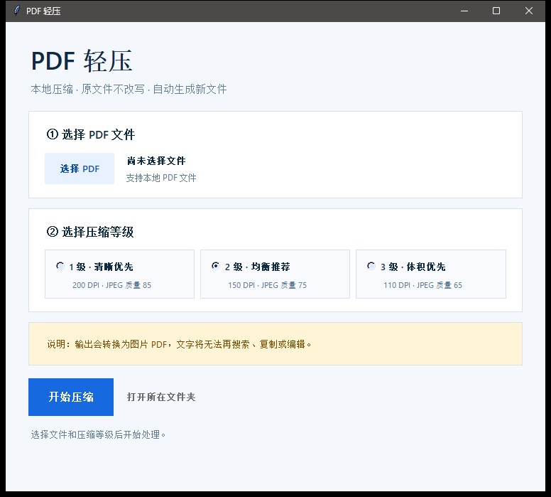

# PDF 轻压

一个本地运行的 Windows PDF 压缩工具。选择 PDF、选择 1–3 级压缩，程序会在原文件同目录创建新文件，原文件不会被改写。

## 界面预览



## 功能

- 仅处理本地 PDF，不上传文件。
- 提供 1、2、3 级压缩，默认 2 级均衡模式。
- 自动生成新文件；重名时自动追加 `(2)`、`(3)`，不会覆盖原文件。
- 显示压缩前后大小、压缩比例和输出位置。
- 可直接打开输出文件所在目录。
- 对损坏、加密或无法写入的文件给出中文提示，并清理未完成的输出。

## 快速使用

1. 打开 `dist/PDF压缩工具/PDF压缩工具.exe`。
2. 点击“选择 PDF”，选择本地文件。
3. 选择压缩等级，默认推荐 2 级。
4. 点击“开始压缩”。
5. 在原文件目录获取新文件，例如 `报告_压缩_L2.pdf`。

> 将程序复制到其他电脑时，请复制整个 `PDF压缩工具` 文件夹，而不是只复制 EXE。运行不需要安装 Python、Ghostscript 或管理员权限。

## 压缩等级

| 等级 | 适用场景 | 参数 |
| --- | --- | --- |
| 1 级 · 清晰优先 | 文字细节、打印效果更重要 | 200 DPI / JPEG 质量 85 |
| 2 级 · 均衡推荐 | 日常分享与归档 | 150 DPI / JPEG 质量 75 |
| 3 级 · 体积优先 | 优先减小文件体积 | 110 DPI / JPEG 质量 65 |

## 重要限制

为稳定压缩扫描件和图片型 PDF，程序会将每页重新生成为图片 PDF。因此：

- 文字将不能搜索、复制或编辑。
- 超链接、表单、书签、附件和原始矢量内容不会保留。
- 已经高度优化的 PDF 不保证变小，界面会展示实际结果。
- 暂不支持受密码保护、损坏或格式异常的 PDF。

## 发布与运行

发布目录为 `dist/PDF压缩工具/`，其中的 `PDF压缩工具.exe` 可在 64 位 Windows 上直接运行。发布目录已包含应用运行所需组件。

## 本地构建

构建需要 Windows、Python 3.13 和网络访问（或准备好的离线 wheel）。构建脚本使用独立的 `.venv-build` 环境：

```powershell
powershell -ExecutionPolicy Bypass -File scripts/build.ps1
```

离线构建：

```powershell
powershell -ExecutionPolicy Bypass -File scripts/build.ps1 -Offline
```

## 验证三个等级

```powershell
powershell -ExecutionPolicy Bypass -File scripts/verify.ps1 -InputPdf <本地PDF路径>
```

验证结果会写入 `artifacts/verification/results.json`，不会修改传入的源文件。

## 许可证

本程序使用 PyMuPDF。第三方组件和许可证说明见 [THIRD_PARTY_NOTICES.md](THIRD_PARTY_NOTICES.md)。
